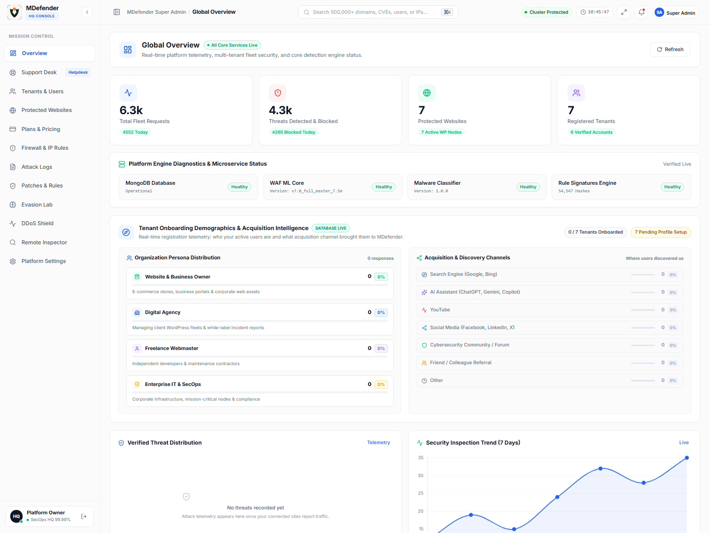
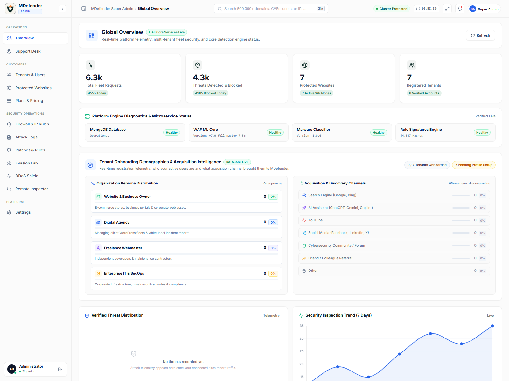
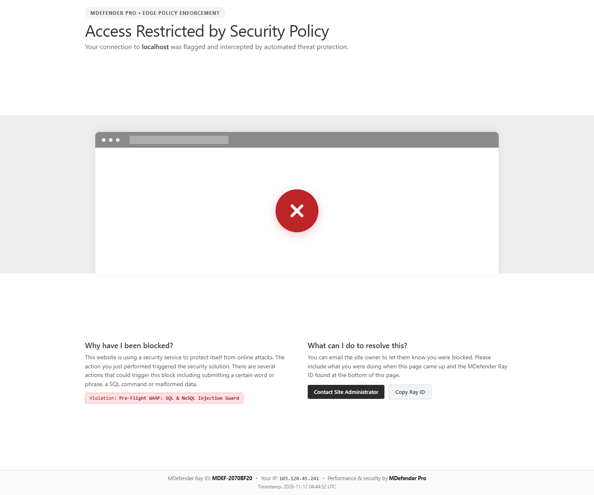
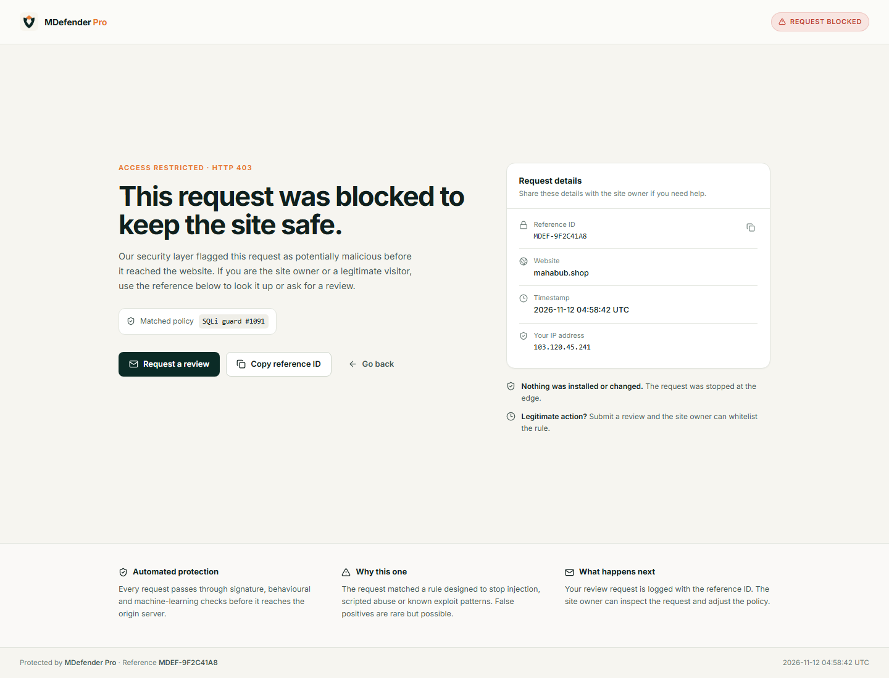
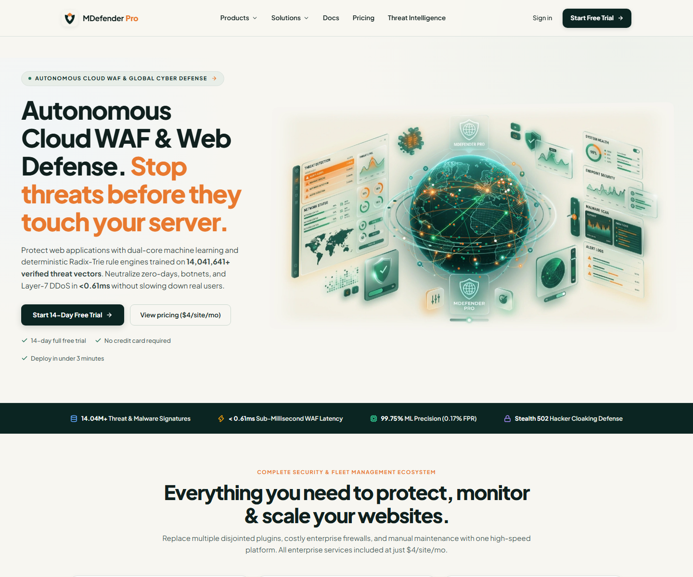
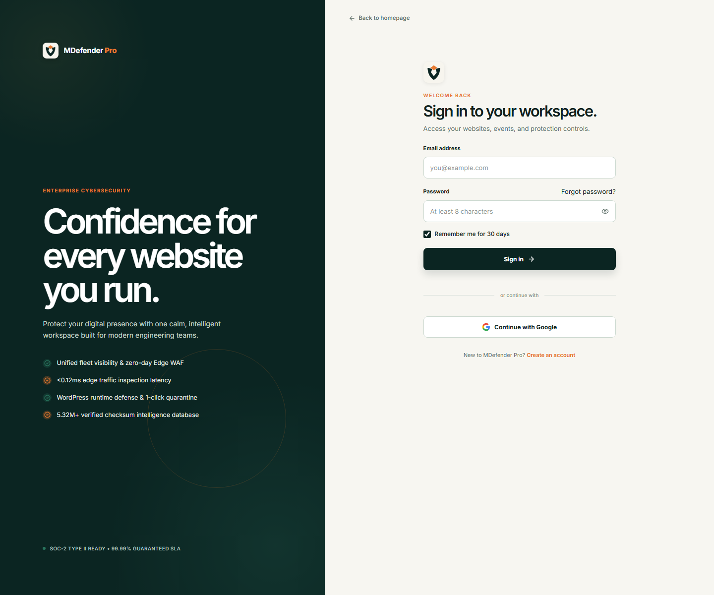
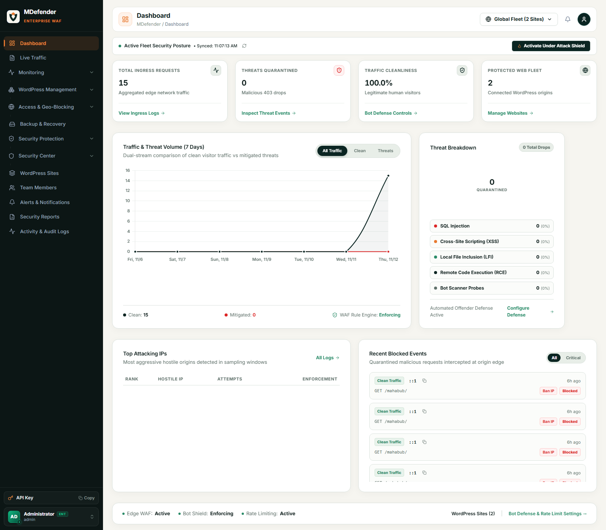
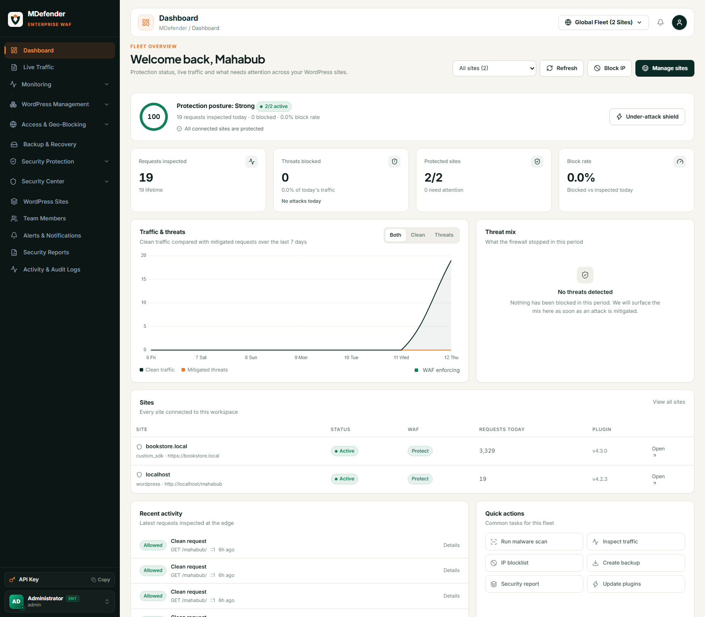
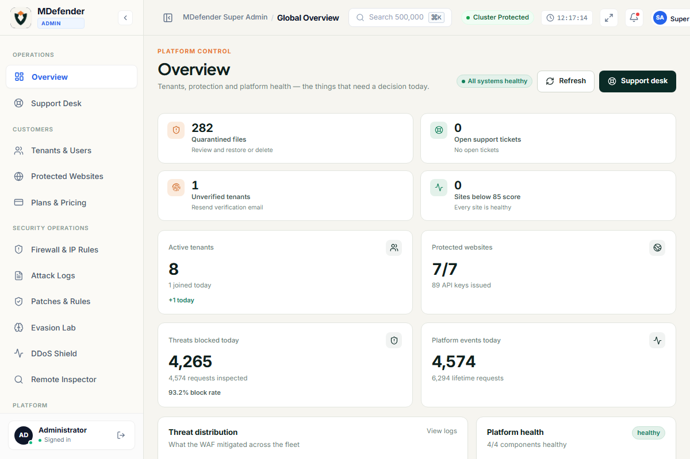

# UI Redesign — progress log (12 November 2026)

**Direction:** warm paper · deep forest · signal amber — one identity across marketing, auth, console and block page.  
**Full plan:** [UI Redesign Roadmap](./UI_REDESIGN_ROADMAP.md)

---

## What shipped today

| # | Change | Files |
|---|---|---|
| 1 | Design token layer (colour, type, spacing, radius, elevation, motion) | `frontend/src/styles/tokens.css` (new), imported in `main.jsx` |
| 2 | Console chrome refresh: warm paper background, 1 px card borders, no pastel icon tiles, 26 px tabular KPI numbers, calmer header | `frontend/src/index.css` (appended override block) |
| 3 | Admin sidebar regrouped into **Operations / Customers / Security operations / Platform**; removed “Mission Control”, “HQ Console”, “Platform Owner”, fake 99.99% label | `frontend/src/components/Sidebar.jsx` |
| 4 | Block page rebuilt from scratch: real 403 layout, request details card, copy Ray ID, review dialog wired to the public false-positive API, responsive, no fake browser mock | `frontend/src/pages/BlockPage.jsx` |
| 5 | bKash removed end-to-end: service, API routes, client methods, env keys, payment config references | `backend/main.py`, `backend/src/services/bkash_service.py` (deleted), `payment_service.py`, `frontend/src/api/api.js`, `backend/.env` |
| 6 | Kept the pricing model at **$4 / site / month, 14-day free trial** (already reflected on `/pricing`) | — |

---

## Before / after

### Admin dashboard — before

### Admin dashboard — after (tokens, grouped nav, neutral KPI cards)

### Block page — before

### Block page — after

### Reference surfaces that define the target language

| Landing | Login |
|---|---|
|  |  |

The login and pricing pages already carry the strongest version of the brand; the redesign brings the console and block page up to that level, then removes the unverified claims.

---

## User dashboard rebuild (first console page)

The user dashboard was rewritten from 1,666 lines of bespoke markup to a composed page built from the new primitives.

**New structure**

1. **Page header** — greeting, one-line purpose, site scope selector, refresh, “Block IP”, “Manage sites”.
2. **Posture strip** — 0–100 protection score ring, active/total sites, today’s requests/blocked/block-rate, and up to three next actions (resume site, enable WAF, install plugin). When healthy it says “All connected sites are protected”.
3. **Four KPI cards** — requests inspected, threats blocked, protected sites, block rate.
4. **Traffic & threats** — 7-day clean vs mitigated chart with Both/Clean/Threats filter and brand colours (forest/amber), plus WAF status.
5. **Threat mix** — doughnut when attacks exist; otherwise a calm “No threats detected” state.
6. **Sites table** — status, WAF mode, requests, plugin version, open action; empty state with “Connect a site”.
7. **Recent activity** — allowed/blocked/mitigated badges, method + URL + IP + relative time, link to logs.
8. **Quick actions** — scan, logs, IP blocklist, backup, report, plugin updates.

**Behaviour**

- Polling reduced from 6 s to 15 s (visible tab only) — less load, same freshness.
- Site scope persists in `mdf_bulk_selected_site` and stays in sync with the global domain selector events.
- Under-attack toggle works per site or fleet-wide.
- Block IP dialog supports block/allow, duration, reason, and refreshes the page state after submit.
- All interactive controls have focus styles; dialog is labelled, Escape-closable and returns focus.

**Before**

**After**

**Data quality note:** the site rows currently show lifetime-ish counters (`requests_today` is not reset per site), so the table total can disagree with the workspace KPI. Tracked as a backend bug in the roadmap (Phase 1, telemetry counters). The UI deliberately labels the site column “Requests”, not “today”.

---

## Admin Overview rebuild

The admin home was the weakest screen: almost-white canvas, pastel KPI tiles, a 0% demographics block above the fold, 12 flat nav items and a header with seven controls. It is now an operator’s morning screen.

**Shell / theme**

- Canvas changed from `#FBFBFB` to the same warm paper as the tenant console (`--md-paper #F6F5F0`), sidebar to warm white `#FBFAF6` with a hairline border — the three near-whites that clashed are gone.
- Removed `zoom: 0.90` from the admin root (it scaled everything down and softened text); layout now renders at 1:1.
- Top bar: clock and the “Cluster Protected” label hide below 1500 px, search is flexible, no overflow at 1366.
- Sidebar grouped into Operations / Customers / Security operations / Platform; “Mission Control” copy removed.

**Content**

1. **Needs attention** — four signal cards with real counts and deep links: quarantined files, open tickets, unverified tenants, sites below 85 score. Green when zero, amber when action is needed.
2. **KPI row** — active tenants (+today), protected websites, threats blocked today with block rate, platform events today.
3. **Threat distribution** — doughnut + legend from the live `/api/admin/stats` aggregates; honest empty state when no attacks exist (no fabricated 7-day chart, because the backend has no daily series).
4. **Platform health** — MongoDB, WAF model version, malware model, signature engine; status per component.
5. **Fleet at risk** — six lowest security scores with tenant, status, score bar, threats, plugin version.
6. **Admin activity** — recent audit-log entries with actor/IP/time.
7. **Tenant & data footprint** — compact counters strip.

**Before**

**After**

> The after shot was captured at 1200 px (headless Chrome became unstable above ~1300 px in this environment), so the four signal/KPI cards wrap 2×2. At ≥1366 px they render as a four-column row by design.

---

## Support inbox & conversation redesign

Both sides of support now share one conversation language.

**Admin — `Support inbox` (was “Support & Incident Command Center”)**

- Three-pane operator layout: ticket list (336 px) · conversation · customer context (286 px); context collapses below 1500 px, single-pane with a back button below 980 px.
- Inbox rows: initials avatar, subject, customer email, one-line snippet, time, status + priority badges. Filters are compact chips with live counts; search covers email, ticket ID and subject.
- Conversation: subject + ticket ID (copy), status/priority badges, per-ticket status select, inspect-site action, delete; messages are chat bubbles — customer left on white, support right on forest tint — with day separators, sender, time and wrapped body.
- Composer: canned replies (Acknowledge / False positive fixed / Need more details / Resolved), “responding as” signature saved locally, status-after-reply select, `Ctrl/⌘ + Enter` to send, compact hint. The “Auto-Wrapper” jargon and “Dispatch Professional Resolution” button are gone.
- Context rail: customer identity, conversation metadata, target site with live diagnostics, quick links (tenant record, WAF events, false-positive lab), response SLA.
- Background follows the console tokens (paper canvas, white thread, warm inbox list) instead of the previous slate/indigo palette.

**Tenant — `UserSupport` thread**

- Message cards replaced with the same bubbles: tenant on the right (forest tint), support on the left (white), 26 px avatars, sender and time, 13 px body.
- Composer compacted with the same hint and `Ctrl/⌘ + Enter` shortcut; the indigo button is now forest.

**Copy changes:** “Support & Incident Command Center” → “Support inbox”; “Dispatch Professional Resolution” → “Send reply”; “Auto-Wrapper … will be added automatically” removed; “Waiting User” → “Waiting on customer”.

---

## Verification

- `npm run build` ✓ (1.55 s) — `index` 384.55 kB / 106.29 kB gzip.
- 103 JS/JSX files parse with Babel; BlockPage and Sidebar parse clean.
- No `__design_probe.html` in `public/` or `dist/` (temporary screenshot helper removed).
- No `bkash` references remain in backend source except legacy generic wallet wording in `payment_service.py` (no bKash gateway, keys or routes).

---

## Next (Admin Overview)

1. Finish the component set (Table with sorting/filters, Drawer, Toast, Tabs) as the admin pages need them.
2. Rebuild **Admin Overview**: posture strip (protected sites, threats 24 h, open incidents, revenue at risk), incident queue, fleet health table; move onboarding demographics behind a “Growth” tab and hide it at 0.
3. Simplify the admin header: breadcrumb + search + status + avatar; remove clock/fullscreen from the default bar.
4. Remove remaining theatrical copy and unverified claims (`SOC-2 TYPE II READY`, `99.99% SLA`, `180+ PoPs`).
5. Rebuild **Admin Users** and **Protected Websites** on the same table/drawer patterns.

**Definition of done:** an operator can answer “what needs attention right now?” from the first screen, and every number on it is real and consistent.
